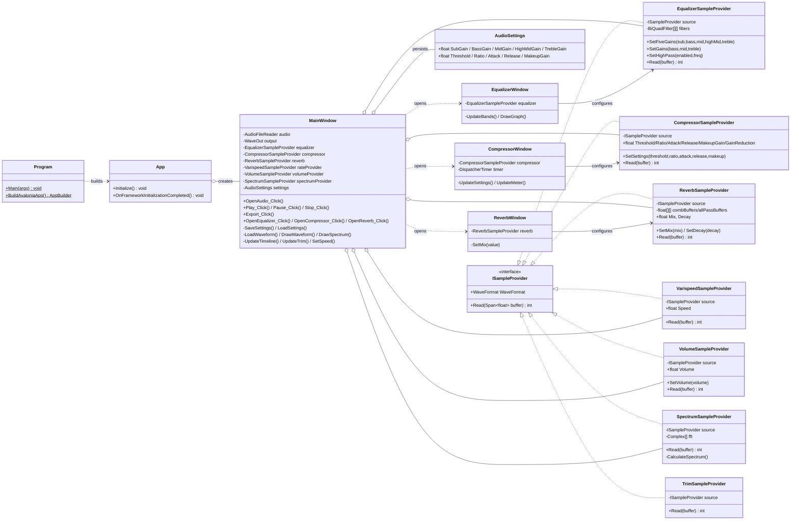
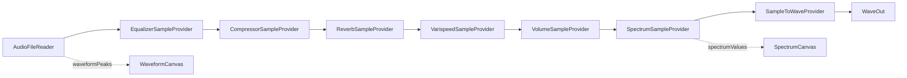
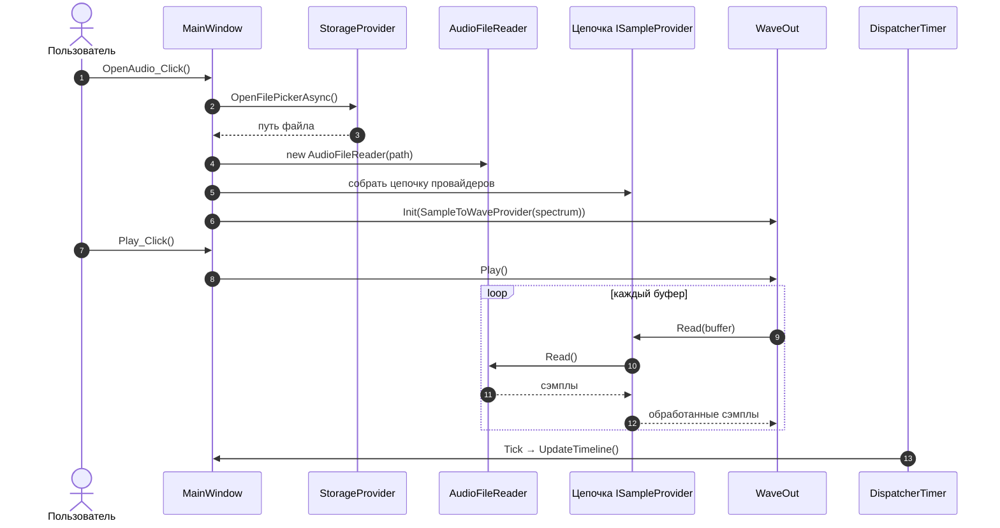
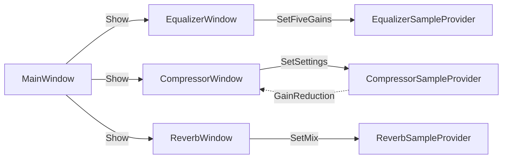

# AudioFX Station — UML диаграмма

Проект: **Avalonia (UI) + NAudio (аудио)**. Ядро архитектуры — интерфейс
`ISampleProvider`, все эффекты реализуют его через **паттерн Decorator**.

## 1. Диаграмма классов

## 2. Цепочка обработки аудио (Decorator)

## 3. Последовательность: открытие файла и воспроизведение

## 4. Взаимодействие окон эффектов

## Ключевые связи
- **Program → App → MainWindow**: точка входа Avalonia создаёт главное окно.
- **MainWindow** — фасад: владеет всеми провайдерами, собирает цепочку, управляет `WaveOut`, хранит `AudioSettings` (JSON).
- **7 провайдеров реализуют `ISampleProvider`** и декорируют друг друга (Decorator).
- **TrimSampleProvider** реализует интерфейс, но в текущей цепочке `MainWindow`/`Export` не используется (заготовка).
- **Окна эффектов** получают ссылку на свой провайдер и настраивают его вживую.
